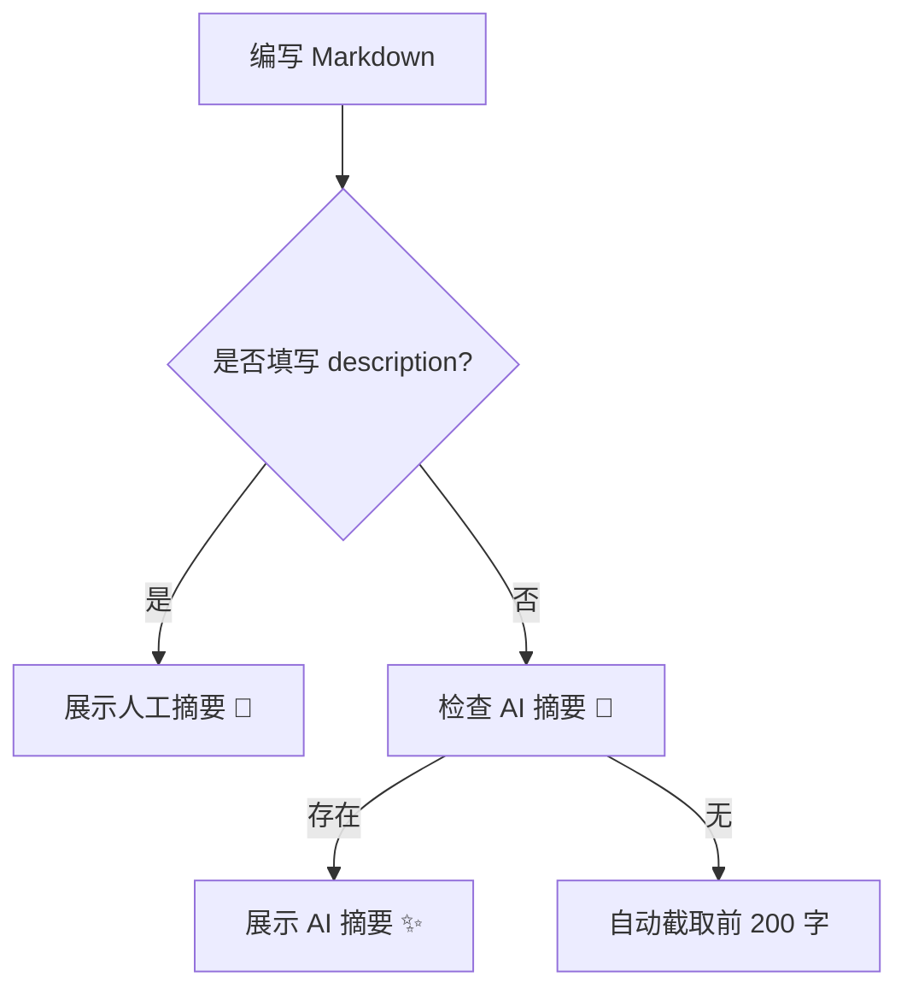

欢迎查阅博客写作指南！本文档汇总了本博客（基于 Astro + Shoka 风格增强）支持的所有写作语法、页面属性配置和排版扩展，可以直接作为模板参考。

---

## 一、文章 Frontmatter 配置（头部元数据）

每篇笔记都是一个独立的 `.md` 文件，放在 `src/content/blog/` 或其子目录（如 `src/content/blog/life/`）下。文章开头使用 YAML 格式声明元数据：

```yaml
---
title: 文章标题（必填）
date: 2026-11-15 12:00:00 # 发布时间（必填，支持 YYYY-MM-DD 或带时分秒）
updated: 2026-11-16 10:00:00 # 更新时间（可选）
link: custom-slug # 自定义文章访问路径/URL，不填则默认使用文件路径
categories: # 分类：支持一维或多级嵌套（例如：[笔记, 前端]）
  - [笔记, 前端]
tags: # 标签列表（可选）
  - Astro
  - Markdown
description: 这是人工填写的摘要。只要写了它，顶部就会显示为「📖 人工摘要」 # （可选）
cover: /images/cover.jpg # 文章封面图地址（可选）
sticky: true # 是否置顶（可选，true 为置顶）
draft: false # 是否为草稿（可选，true 时生产构建会隐藏）
catalog: true # 是否开启文章目录（默认为 true）
tocNumbering: true # 目录是否显示自动编号（设为 false 可关闭层级序号）
excludeFromSummary: false # 是否跳过 AI 摘要生成（可选）
math: true # 是否开启 KaTeX 数学公式渲染（有公式时建议开启）
quiz: true # 是否开启互动答题组件（有练习题时开启）
password: demo # 整篇文章密码保护（可选，读者需输入密码方可阅读）
---
```

### 摘要的生效机制
- **人工摘要**：在 Frontmatter 中配置 `description: "..."`，文章详情页将自动显示 **「📖 人工摘要」**，并优先用于 SEO 与卡片预览。
- **AI 摘要**：不写 `description` 且运行过 `pnpm koharu generate summaries` 时，展示 **「✨ AI 摘要」**。
- **自动摘要**：若两者均无，自动截取正文前 200 字作为备选展示。

---

## 二、基础文本与 Markdown 扩展特效

除了标准的 Markdown 语法（粗体 `**text**`、斜体 `*text*`、删除线 `~~text~~`），主题还支持丰富的行内视觉效果：

### 1. 下划线与着重号 (ins)

```markdown
++普通下划线文字++
++波浪下划线++{.wavy}
++着重点标记++{.dot}

++主色调++{.primary}  ++成功++{.success}  ++警告++{.warning}  ++危险++{.danger}  ++信息++{.info}
```

**展示效果**：
- ++普通下划线文字++
- ++波浪下划线++{.wavy}
- ++着重点标记++{.dot}
- ++主色调++{.primary} ++成功++{.success} ++警告++{.warning} ++危险++{.danger} ++信息++{.info}

### 2. 高亮背景 (mark) 与上下标

```markdown
==这是亮黄色背景的高亮文字==

水的化学式是 H~2~O，爱因斯坦质能方程是 E = mc^2^。
```

**展示效果**：
- ==这是亮黄色背景的高亮文字==
- 水的化学式是 H~2~O，爱因斯坦质能方程是 E = mc^2^。

### 3. 彩色字体与彩虹渐变

```markdown
[红色]{.red} [粉色]{.pink} [橙色]{.orange} [黄色]{.yellow} [绿色]{.green} [水色]{.aqua} [蓝色]{.blue} [紫色]{.purple} [灰色]{.grey}

[这段文字呈现流动的彩虹渐变视觉效果]{.rainbow}
```

**展示效果**：
- [红色]{.red} [粉色]{.pink} [橙色]{.orange} [黄色]{.yellow} [绿色]{.green} [水色]{.aqua} [蓝色]{.blue} [紫色]{.purple} [灰色]{.grey}
- [这段文字呈现流动的彩虹渐变视觉效果]{.rainbow}

### 4. 键盘按键样式 (kbd)

```markdown
按 [Ctrl]{.kbd} + [C]{.kbd} 复制，按 [Ctrl]{.kbd} + [V]{.kbd} 粘贴。
```

**展示效果**：
- 按 [Ctrl]{.kbd} + [C]{.kbd} 复制，按 [Ctrl]{.kbd} + [V]{.kbd} 粘贴。

### 5. 剧透与防窥遮罩 (Spoiler)

```markdown
黑条遮挡：!!这是剧透内容，鼠标悬停或点击后显示!!
高斯模糊：!!这段私密文字经过高斯模糊处理，鼠标悬停时清晰!!{.blur}
```

**展示效果**：
- 黑条遮挡：!!这是剧透内容，鼠标悬停或点击后显示!!
- 高斯模糊：!!这段私密文字经过高斯模糊处理，鼠标悬停时清晰!!{.blur}

### 6. 汉字注音 (Ruby)

```markdown
{漢字^かんじ} 是指汉字在日文中的注音。
{苏和^supeace} 的博客。
```

**展示效果**：
- {漢字^かんじ} 是指汉字在日文中的注音。
- {苏和^supeace} 的博客。

### 7. 行内徽章与状态标签 (Labels)

```markdown
[默认]{.label .default} [主要]{.label .primary} [信息]{.label .info} [成功]{.label .success} [警告]{.label .warning} [危险]{.label .danger}
```

**展示效果**：
- [默认]{.label .default} [主要]{.label .primary} [信息]{.label .info} [成功]{.label .success} [警告]{.label .warning} [危险]{.label .danger}

---

## 三、容器与排版区块

### 1. 提醒块 (Note Blocks)

使用 `:::类型` 开启区块，以 `:::` 结尾。可附加 `no-icon` 隐藏图标：

```markdown
:::info
**提示**：这是一个信息提示块，常用于附加补充说明。
:::

:::success
**操作成功**：这是一个绿色成功块。
:::

:::warning
**注意**：这是一个黄色警告块。
:::

:::danger
**危险**：这是一个红色警告块，表示风险操作。
:::

:::primary no-icon
这是一个没有图标的主色调提示块。
:::
```

**展示效果**：

:::info
**提示**：这是一个信息提示块，常用于附加补充说明。
:::

:::success
**操作成功**：这是一个绿色成功块。
:::

:::warning
**注意**：这是一个黄色警告块。
:::

:::danger
**危险**：这是一个红色警告块，表示风险操作。
:::

---

### 2. 折叠详情块 (Collapse)

使用 `+++颜色 标题` 语法，支持嵌套 Markdown、代码块等：

````markdown
+++primary 点击展开查看详细配置
这里是折叠内部的正文内容：
- 支持列表
- 支持引用
- 点击标题即可自由展开/收起
+++

+++danger 危险命令警告
请勿在生产服务器随意运行以下命令：
```bash
rm -rf /
```
+++
````

**展示效果**：

+++primary 点击展开查看详细配置
这里是折叠内部的正文内容：
- 支持列表
- 支持引用
- 点击标题即可自由展开/收起
+++

+++danger 危险命令警告
请勿在生产服务器随意运行以下命令：
```bash
rm -rf /
```
+++

---

### 3. 多标签卡切换 (Tabs)

使用 `;;;分组ID 标签页名称` 语法组合：

````markdown
;;;lang-demo JavaScript
```javascript
console.log('Hello from JavaScript!');
```
;;;

;;;lang-demo Python
```python
print('Hello from Python!')
```
;;;

;;;lang-demo Rust
```rust
println!("Hello from Rust!");
```
;;;
````

**展示效果**：

;;;lang-demo JavaScript
```javascript
console.log('Hello from JavaScript!');
```
;;;

;;;lang-demo Python
```python
print('Hello from Python!')
```
;;;

;;;lang-demo Rust
```rust
println!("Hello from Rust!");
```
;;;

---

### 4. Obsidian Callout 自动兼容

直接粘贴 Obsidian 的 `> [!type]` 语法即可自动转换为对应的提醒块或折叠块，无需手动删改 `>`：

- **普通 Callout**（`>[!type]` 或 `> [!type] 标题`）→ 自动渲染为提醒块（支持标题内嵌公式、内部多级列表等）
- **可折叠 Callout**（`> [!type]+ 标题` 默认展开、`> [!type]- 标题` 默认收起）→ 自动渲染为折叠详情块
- **类型映射**：
  - `info`：`note`、`info`、`todo`
  - `primary`：`tip`、`hint`、`important`、`abstract`、`summary`、`tldr`、`primary`
  - `success`：`success`、`check`、`done`
  - `warning`：`warning`、`caution`、`attention`、`question`、`help`、`faq`
  - `danger`：`danger`、`failure`、`fail`、`missing`、`error`、`bug`
  - `default`：`example`、`quote`、`cite`、`default`

```markdown
>[!note]
>无标题的 Obsidian Callout，自动渲染为信息提醒块。

>[!tip] 带标题与公式的提示块（$E = mc^2$）
>1. 支持有序与无序列表
>	- 支持保留 Tab / 空格缩进的子列表
>2. 支持块级公式：$$X = A_{dp} A_{sp}^T$$

> [!warning]- 点击展开查看注意事项（默认折叠）
> 使用 `-` 号时渲染为默认收起的折叠块；使用 `+` 号时默认展开。
```

**展示效果**：

> [!note]
>无标题的 Obsidian Callout，自动渲染为信息提醒块。

> [!tip] 带标题与公式的提示块（$E = mc^2$）
>1. 支持有序与无序列表
>	- 支持保留 Tab / 空格缩进的子列表
>2. 支持块级公式：$$X = A_{dp} A_{sp}^T$$

> [!warning]- 点击展开查看注意事项（默认折叠）
> 使用 `-` 号时渲染为默认收起的折叠块；使用 `+` 号时默认展开。

---

## 四、代码块增强与参数

代码块基于 Shiki 语法高亮，并扩展了丰富的元参数：

````markdown
```typescript title="src/utils.ts" url="https://github.com" linkText="查看源码" mark:1,3
// 第 1 行有背景高亮标记
const greeting: string = "Hello World";
// 第 3 行也有高亮标记
console.log(greeting);
```
````

**支持参数**：
- `title="文件名"`：代码块顶部显示文件名。
- `url="..."` 与 `linkText="..."`：代码块右上角放置跳转外链。
- `mark:1,3-5`：高亮指定行数。
- `command:("$":1-2)`：终端命令前缀模拟。

---

## 五、独行链接自动嵌入 (Embed)

只需在文章中将 URL **单独占一行**，系统会自动拉取 Open Graph 元信息生成卡片，或渲染嵌入组件：

```markdown
# 独行 GitHub 仓库卡片
https://github.com/withastro/astro

# 独行 Twitter / X 嵌入
https://x.com/vercel_dev/status/1997059920936775706

# 独行 CodePen 嵌入
https://codepen.io/botteu/pen/YPKBrJX/
```

> **注意**：如果写在普通段落中（如 `[链接名](https://...)`），则只渲染普通超链接，不会变成卡片。

---

## 六、数学公式 (KaTeX)

在 Frontmatter 中开启 `math: true` 即可渲染高质量公式：

```markdown
行内公式：质能公式为 $E = mc^2$，欧拉公式为 $e^{i\pi} + 1 = 0$。

独立块级公式：
$$
\int_{-\infty}^{\infty} e^{-x^2} dx = \sqrt{\pi}
$$
```

**展示效果**：
行内公式：质能公式为 $E = mc^2$。

$$
\int_{-\infty}^{\infty} e^{-x^2} dx = \sqrt{\pi}
$$

---

## 七、Mermaid 图表

使用 ````mermaid 代码块直接绘制流程图、时序图等：

````markdown

````

**展示效果**：


---

## 八、AntV Infographic 可视化信息图

博客内置集成了 **[@antv/infographic](https://infographic.antv.vision/)** 可视化信息图引擎。使用 ````infographic 代码块即可直接生成高颜值的结构化图表，适合展示流程、清单卡片、架构层级、路线图与对比分析。

### 1. 基础语法与卡片网格示例

第一行声明 `infographic <模板名>`，接着用缩进结构定义 `data`，条目中可使用 `icon: mdi/图标名` 引入图标：

````markdown
```infographic
infographic list-grid-badge-card
data
  title 核心架构与技术栈
  desc 博客所依赖的关键技术与组件
  items
    - label Astro 7.x
      desc 内容驱动的高性能静态站点框架
      icon mdi/rocket-launch
    - label React
      desc 交互组件与客户端状态驱动
      icon mdi/react
    - label Tailwind CSS
      desc 现代化原子样式与主题响应
      icon mdi/language-css3
    - label AntV Infographic
      desc 结构化知识与信息图可视化引擎
      icon mdi/chart-box-outline
```
````

**展示效果**：

```infographic
infographic list-grid-badge-card
data
  title 核心架构与技术栈
  desc 博客所依赖的关键技术与组件
  items
    - label Astro 7.x
      desc 内容驱动的高性能静态站点框架
      icon mdi/rocket-launch
    - label React
      desc 交互组件与客户端状态驱动
      icon mdi/react
    - label Tailwind CSS
      desc 现代化原子样式与主题响应
      icon mdi/language-css3
    - label AntV Infographic
      desc 结构化知识与信息图可视化引擎
      icon mdi/chart-box-outline
```

### 2. 步骤流程图示例 (Sequence)

````markdown
```infographic
infographic sequence-zigzag-steps-underline-text
data
  title 文章发布流程
  items
    - label 构思构架
      desc 确定主题与结构大纲
    - label 编写 Markdown
      desc 结合排版特性撰写内容
    - label 本地预览
      desc 运行 pnpm dev 确认渲染
    - label 代码推送
      desc 推送到 GitHub 自动触发部署
```
````

**展示效果**：

```infographic
infographic sequence-zigzag-steps-underline-text
data
  title 文章发布流程
  items
    - label 构思构架
      desc 确定主题与结构大纲
    - label 编写 Markdown
      desc 结合排版特性撰写内容
    - label 本地预览
      desc 运行 pnpm dev 确认渲染
    - label 代码推送
      desc 推送到 GitHub 自动触发部署
```

### 3. 常用模板速查

| 分类 | 常用模板名 | 适用场景 |
| :--- | :--- | :--- |
| **列表卡片** | `list-grid-badge-card`、`list-grid-candy-card-lite`、`list-row-horizontal-icon-arrow` | 技术栈、清单、特性盘点 |
| **步骤流程** | `sequence-zigzag-steps-underline-text`、`sequence-roadmap-vertical-simple`、`sequence-circular-simple` | 步骤图、路线图、时间线、生命周期 |
| **对比分析** | `compare-binary-horizontal-simple-fold`、`compare-swot` | 方案二选一、优劣势对比、SWOT 分析 |
| **层级架构** | `hierarchy-structure`、`hierarchy-tree-tech-style-capsule-item` | 模块依赖、组织结构、知识图谱 |
| **数据统计** | `chart-pie-plain-text`、`chart-column-simple`、`chart-line-plain-text` | 占比饼图、柱状统计、折线趋势 |

> **提示**：信息图卡片顶部提供了 Mac 风格的窗口操作区，点击全屏按钮可平移缩放查看大图，亦支持一键切换源码或复制 SVG。

---

## 九、局部加密内容 (Encrypted Block)

如果只想隐藏文章中的敏感账号、网盘提取码或特定章节，可使用局部加密块（构建期通过 AES-256-GCM 加密，爬虫无法获取明文）：

````markdown
:::encrypted{password="123456"}
这里是加密内容，输入密码 `123456` 后可解密查看：
- 百度网盘链接：https://pan.baidu.com/...
- 提取码：abcd
:::
````

**展示效果**：

:::encrypted{password="123456"}
这里是加密内容，输入密码 `123456` 后可解密查看：
- 百度网盘链接：https://pan.baidu.com/...
- 提取码：abcd
:::

---

## 十、练习题交互组件 (Quiz)

在 Frontmatter 开启 `quiz: true` 后，可以插入交互式选择题或填空题：

```markdown
- Astro 默认采用什么架构渲染页面？{.quiz}
  - SPA 单页架构{.options}
  - 孤岛架构 (Islands Architecture){.correct}
  - 全量客户端渲染 (CSR){.options}

> 解析：Astro 采用 Islands 架构，默认输出零 JavaScript 的静态 HTML，仅对指定组件进行局部水合。
```

**展示效果**：

- Astro 默认采用什么架构渲染页面？{.quiz}
  - SPA 单页架构{.options}
  - 孤岛架构 (Islands Architecture){.correct}
  - 全量客户端渲染 (CSR){.options}

> 解析：Astro 采用 Islands 架构，默认输出零 JavaScript 的静态 HTML，仅对指定组件进行局部水合。

---

## 十一、常用开发与写作命令

```bash
# 1. 启动本地开发预览
pnpm dev              # 启动本地服务，在浏览器访问 http://localhost:4321

# 2. 生成 AI 摘要（需先配置或启动本地 LLM 如 LM Studio）
pnpm koharu generate summaries

# 3. 生成图片占位模糊图 (LQIP)
pnpm koharu generate lqips

# 4. 生成文章语义相似度向量（用于相关文章推荐）
pnpm koharu generate similarities

# 5. 一键生成所有资源
pnpm koharu generate all

# 6. 代码质量检查与修复
pnpm lint:fix
pnpm check
```

祝写作愉快！
